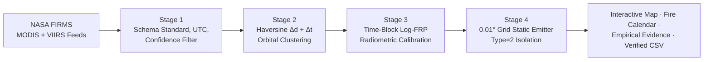

# KOZ Atlas

**Multi-Satellite Active Fire & Thermal Anomaly Harmonization Platform**

[](https://koz-atlas-gbqjscepvmqcaygzbjlxhq.streamlit.app/)
[](https://opensource.org/licenses/MIT)
[](https://www.spaceappschallenge.org/2026/challenges/modis-and-viirs-hot-spots/)

| Category | Details |
|---|---|
| **Competition** | 2026 NASA International Space Apps Challenge — Batman Local Event (Prof. Dr. Narin Nasıroğlu Science & Innovation Center, Nov 14–15, 2026) |
| **Challenge** | [Harmonization of MODIS and VIIRS Hot Spots](https://www.spaceappschallenge.org/2026/challenges/modis-and-viirs-hot-spots/) (Advanced Level) |
| **Team** | **Kirvecanlar** — Batman University Department of Computer Engineering |
| **Live Web App 1** | https://koz-atlas2.streamlit.app/ |
| **Live Web App 2** | https://koz-atlas-gbqjscepvmqcaygzbjlxhq.streamlit.app/ |
| **Repository** | https://github.com/MehmetHalilKILIC/koz-atlas |
| **Data Sources** | NASA FIRMS Area API & Archive — [Space Apps FIRMS Guide (#2016)](https://github.com/nasa/spaceapps/discussions/2016) |

### Team Members & Roles

| Member | Role & Responsibilities |
|---|---|
| **Mehmet Halil KILIÇ** (Team Lead) | Data Engineering, Orbital Haversine Clustering, and Log-FRP Huber Calibration Engine |
| **İbrahim Halil BİRLİK** | Backend Architecture, GIS Spatial Integration, and Type=2 Static Thermal Source Analytics |
| **Mirze KARA** | Front-End UI/UX, Burning Activity Calendar, 2D/3D WebGL Visualization, and Presentation Strategy |

---

## 1. Problem Statement

Satellite-based active fire monitoring is currently facing a historic generational transition:
- **MODIS** (onboard NASA Terra and Aqua satellites): Has provided continuous active fire and thermal anomaly records since 2000 at ~1 km × 1 km nadir spatial resolution. However, both Terra (morning ~10:30 LT) and Aqua (afternoon ~13:30 LT) are reaching orbital decay and planned decommissioning in 2027.
- **VIIRS** (onboard Suomi-NPP, NOAA-20, and NOAA-21): Provides higher spatial resolution at 375 m × 375 m (I-Band) and enhanced radiometric sensitivity.
- **The November 2, 2026 Satellite Constellation Disruption**: According to NASA FIRMS operational bulletins, as of **November 2, 2026**, the Suomi-NPP VIIRS Near Real-Time (NRT) stream was officially discontinued, transitioning operational duty to NOAA-20 and NOAA-21. Legacy systems querying defunct S-NPP endpoints fail with HTTP 400 errors.
- **The Core Scientific Dilemma**: Raw hotspot records across MODIS and VIIRS cannot be combined directly. A single 1 km MODIS fire pixel appears as **4 to 12 distinct sub-pixels** in VIIRS (~7.1x areal ratio), and VIIRS detects small, low-intensity fires (<12 MW) that remain below the MODIS detection threshold. Naive concatenation causes an artificial "fire frequency jump" after 2012, rendering current fire seasons impossible to benchmark against the 20+ year historical baseline.

---

## 2. Solution: 4-Stage Harmonization Pipeline

KOZ Atlas solves these physical and temporal discrepancies through a principled, four-stage spatiotemporal pipeline operating under **Zero Data Leakage** principles:



### Stage 1 — Ingestion, Schema Harmonization & Confidence Filtering
- **NASA FIRMS Area API Client**: `https://firms.modaps.eosdis.nasa.gov/api/area/csv/{MAP_KEY}/{SOURCE}/{AREA_COORDS}/{DAY_RANGE}/{DATE}`. To prevent strict NASA API HTTP 400 Bad Request limits, requests are automatically partitioned into safe ≤5-day slices and merged asynchronously.
- **Supported Sensor Streams**: `MODIS_NRT`, `MODIS_SP`, `VIIRS_SNPP_NRT`, `VIIRS_SNPP_SP`, and operational `VIIRS_NOAA20_NRT`. Standalone FIRMS archive CSVs can also be uploaded directly.
- **Radiometric Attribute Mapping**: MODIS `brightness`/`bright_t31` and VIIRS `bright_ti4`/`bright_ti5` channels are unified into standardized brightness temperature fields (Kelvin).
- **Unified Confidence Scale**: MODIS 0–100 numeric confidence is mapped to `low` (<30), `nominal` (30–79), and `high` (≥80); VIIRS `l`/`n`/`h` is standardized to `low`/`nominal`/`high`.
- **Temporal Alignment**: `acq_date` + `acq_time (HHMM)` are parsed into exact `utc_timestamp` and `utc_end`.

### Stage 2 — Orbit-Aware Vectorized Haversine Clustering
$$d = 2R \arcsin\left(\sqrt{\sin^2\left(\frac{\Delta \phi}{2}\right) + \cos\phi_1\cos\phi_2\sin^2\left(\frac{\Delta \lambda}{2}\right)}\right),\quad R = 6371.0\ \text{km}$$

- **Orbit Timing Isolation**: Isolates morning Terra passes (~10:30 LT) from afternoon Aqua and VIIRS passes (~13:30 LT) to prevent diurnal cycle skew.
- **Coincidence Matching Condition**: Pairwise spatial distance $d \le \Delta d$ (default 1.2 km; adjustable 0.5–2.5 km to accommodate MODIS scan-angle expansion) **and** $| \Delta t | \le 60\text{ min}$ (adjustable 10–180 min).
- **High-Performance KD-Tree**: Candidate pairs are located via 4D KD-tree (unit sphere Cartesian $x, y, z$ + scaled time) and verified via exact spherical Haversine formulas. Connected components form unified **Harmonized Fire Events** (`KOZ-YYYYMMDD-seq`).
- **Cluster Centroid & Classification**: Event coordinates are computed as FRP-weighted centroids. Events are tagged as `BOTH (MODIS+VIIRS)`, `VIIRS_CLUSTER_HARMONIZED`, or `MODIS_ONLY`.

### Stage 3 — Time-Block Log-FRP Radiometric Calibration
- **Chronological Data Partitioning**: Enforces strict temporal block splitting (75% historical training block, 25% future test block) to prevent look-ahead data leakage.
- **Robust Huber Regression**: Fits a robust estimator in log-transformed space on coincident afternoon events:
  $$\log(1 + \text{FRP}_{\text{MODIS}}) = \beta_0 + \beta_1 \cdot \log(1 + \text{FRP}_{\text{VIIRS}})$$
- **Physical Inversion**: Calibrates VIIRS radiant heat output back to the 20+ year MODIS scale:
  $$\widehat{\text{FRP}}_{\text{Calibrated}} = \exp\left(\beta_0 + \beta_1 \cdot \log(1 + \text{FRP}_{\text{VIIRS}})\right) - 1$$
- **Empirical Detection Curve**: Evaluates MODIS detection sensitivity across 6 VIIRS FRP energy bins (0–5, 5–10, 10–20, 20–40, 40–80, 80+ MW), deriving `modis_eq_weight`.
- **Active Fire Cell-Days**: Aggregates events onto a ~1 km spatial grid × UTC day unit. Even as satellite constellations evolve (Terra/Aqua → Suomi-NPP → NOAA-20/21), the resulting time series remains on an invariant scale.

### Stage 4 — 0.01° Grid Static Industrial Thermal Source Isolation
- Gas flaring stacks, petroleum refineries, and industrial smelters produce persistent thermal anomalies that corrupt ecological fire baselines.
- **Dual Isolation Logic**:
  1. Reads definitive NASA MCD14ML `Type=2` (Static Land Source) tags.
  2. Implements automated spatial grid persistence tracking: any 0.01° × 0.01° (~1.1 km) cell exhibiting activity across $\ge 5$ distinct days **and** $\ge 4$ distinct months within the same calendar year is isolated as a Static Industrial Site (`STK-###`).
- Users can toggle industrial isolation with a single click to produce an ecologically sanitized **Burning Activity Calendar**.

---

## 3. Web Application Modules

| Module | Features & Capabilities |
|---|---|
| **Control Sidebar** | Select AOI (Turkey, Batman Basin, Mediterranean Belt, Custom Bounding Box), data mode (Demo / Live FIRMS API / CSV upload), date range, $\Delta d$, $\Delta t$, confidence threshold, and advanced calibration settings. |
| **Top KPI Cards** | Live metric cards displaying Raw Hotspots, KOZ Harmonized Events, Duplication Reduction %, Static Industrial Sites, and Mean Calibrated FRP. |
| **Tab 1: Interactive GIS Satellite Map** | Folium WebGL engine supporting Esri Dark Canvas and Esri HD World Imagery basemaps. Renders Raw MODIS 1 km footprints, Raw VIIRS 375 m circles, KOZ Harmonized Events (size $\propto$ FRP), and purple industrial refinery markers with full telemetry popups. |
| **Tab 2: Burning Activity Calendar** | Multi-scale Year × Month heat matrix. Evaluates the selected month against its 20+ year historical median, computing anomaly ratios ($1.00\times$ = normal), percentiles, Q1–Q3 seasonal distribution envelopes, and daily event histograms. |
| **Tab 3: Sensor Harmonization Evidence** | Long-term time series comparisons (1998–Present), 2012 sensor break ratios (verifying reduction of artificial jumps from $3.8\times$ down to $1.11\times$), MODIS vs. VIIRS log-FRP correlation scatter plots, and empirical detection sensitivity curves. |
| **Tab 4: Data Download Center** | Instant export of `koz_atlas_harmonized_hotspots.csv`, static source registries, raw-pixel-to-event mapping tables, and reproducible run metadata in formatted JSON. Includes a complete CSV column dictionary. |

---

## 4. Installation & Local Execution

### Prerequisites
- Python 3.10, 3.11, 3.12, or 3.13
- Git

### Quickstart

```bash
# Clone the repository
git clone https://github.com/MehmetHalilKILIC/koz-atlas.git
cd koz-atlas

# Install required dependencies
pip install -r requirements.txt

# Launch the Streamlit application
streamlit run app.py
```

### Running Unit & Smoke Tests

```bash
# Run core scientific engine unit tests
python tests/test_harmonizer.py

# Run headless Streamlit UI smoke tests
python tests/test_app.py
```

### Generating Presentations & Reports

```bash
# Generate 7-slide jury presentations (TR & EN in PPTX and PDF)
python presentation/build_all_presentations.py

# Generate comprehensive technical reports (TR & EN in DOCX and Portrait PDF)
python docs/build_all_reports.py
```

---

## 5. Repository Structure

```
koz-atlas/
├── app.py                         Streamlit web application (4 tabs, interactive GIS, calendar)
├── harmonizer.py                  Scientific engine (Stages 1–4, FIRMS client, synthetic simulator)
├── requirements.txt               Python dependencies
├── .streamlit/
│   └── config.toml                Dark space mission control theme configuration
├── data/
│   └── demo_firms.parquet         Pre-computed 20+ year baseline dataset for instant sub-second boot
├── tests/
│   ├── test_harmonizer.py         Unit tests for Haversine, KD-tree, and static detection
│   └── test_app.py                Headless smoke test for Streamlit interface
├── presentation/
│   ├── build_all_presentations.py Standalone builder for TR & EN PPTX and 16:9 PDF decks
│   ├── build_presentation.py      Legacy PPTX presentation generator
│   ├── KOZ_Atlas_Presentation_EN.pptx
│   ├── KOZ_Atlas_Presentation_EN.pdf
│   ├── KOZ_Atlas_Sunum_TR.pptx
│   ├── KOZ_Atlas_Sunum_TR.pdf
│   └── assets/                    High-resolution diagrams, topography grids, and satellite scanning models
└── docs/
    ├── build_all_reports.py       Standalone builder for TR & EN DOCX and Portrait PDF reports
    ├── KOZ_Atlas_Technical_Report_EN.docx
    ├── KOZ_Atlas_Technical_Report_EN.pdf
    ├── KOZ_Atlas_Teknik_Rapor_TR.docx
    └── KOZ_Atlas_Teknik_Rapor_TR.pdf
```

---

## 6. The 5 Scientific Integrity Boundaries ("What We Do Not Claim")

Remote sensing science demands complete transparency regarding algorithmic scope. KOZ Atlas formally declares five scientific integrity principles:

1. **No Synthetic Super-Resolution (Downscaling)**: We do not synthesize fictitious 375 m sub-pixels from 1 km MODIS historical footprints. Our goal is radiometric and statistical harmonization of FRP to preserve long-term climate continuity.
2. **Zero FRP Does Not Mean Absence of Combustion**: Cells showing 0 MW in the calendar may stem from cloud obscuration, thick pyrocumulonimbus smoke shading, or orbital swath gaps rather than confirmed absence of fire.
3. **Strict NRT vs. SP Segregation**: Operational near real-time streams (NRT) are strictly segregated from calibrated Science Products (SP). Calibration models are fitted exclusively on definitive SP archives.
4. **Detectability as Empirical Lower Bound**: Detection curves represent observed clear-sky satellite coincidence under real-world conditions, serving as empirical lower bounds rather than theoretical combustibility.
5. **Precautionary Static Classification**: Persistent thermal emitters identified outside official NASA MCD14ML `Type=2` flags are designated as candidate industrial sites for ground inspection rather than dogmatically altered.

---

## 7. References & Data Citations

1. **NASA Space Apps Challenge 2026**: *Harmonization of MODIS and VIIRS Hot Spots* — [Challenge Description](https://www.spaceappschallenge.org/2026/challenges/modis-and-viirs-hot-spots/)
2. **NASA Earth Science Data and Information System (ESDIS)**: *Fire Information for Resource Management System (FIRMS) Operational Documentation & Nov 2, 2026 Transition Notice*
3. **Giglio, L., Schroeder, W., & Justice, C. O. (2016)**: *The collection 6 MODIS active fire detection algorithm and products.* Remote Sensing of Environment, 178, 31–41.
4. **Schroeder, W., Oliva, P., Giglio, L., & Csiszar, I. A. (2014)**: *The New VIIRS 375 m active fire detection product.* Remote Sensing of Environment, 143, 85–96.
5. **Wooster, M. J., Zhukov, B., & Oertel, D. (2005)**: *Fire radiative energy for quantitative study of biomass burning: derivation from the BIRD experimental satellite.* Remote Sensing of Environment, 95(1), 48–66.
6. **KOZ Atlas Live Production Deployment**: [koz-atlas-gbqjscepvmqcaygzbjlxhq.streamlit.app](https://koz-atlas-gbqjscepvmqcaygzbjlxhq.streamlit.app/)
7. **KOZ Atlas Open-Source Code Repository**: [github.com/MehmetHalilKILIC/koz-atlas](https://github.com/MehmetHalilKILIC/koz-atlas)
